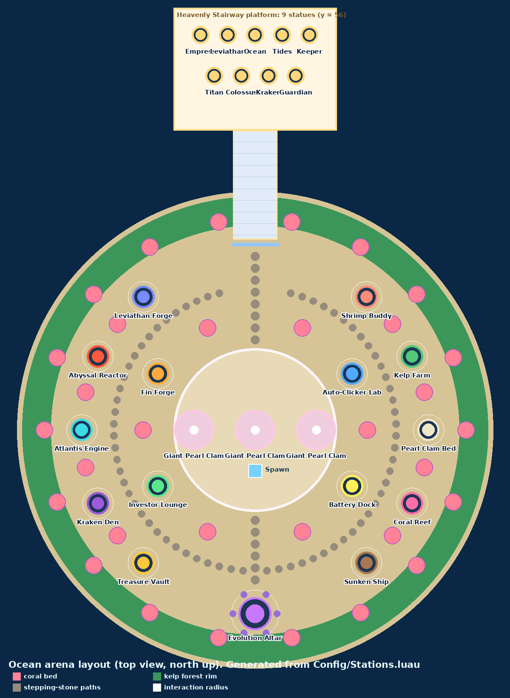

# Ocean Idle: Roblox "Business Empire" idle game

A server-authoritative, strictly typed (`--!strict`) Luau foundation for a 3D underwater idle game.
It targets ages 9–12 and runs on mobile. Up to **8 players** each get their own reef (an instanced zone) around a
shared Hub. Players walk around and step on floor pads to discover **mystery businesses** ("???" deeds), buy
**Multiplier** and **Speed** upgrades, hire **managers** for automation, and trigger **global buffs**. They then
**Evolve** at the Hub for permanent x42 multipliers and finally raise **Statues** on the Heavenly Stairway.
Everyone can see everyone's reef; only the owner can buy on it.



## File structure

```
default.project.json         Rojo project (Shared → ReplicatedStorage, Server → ServerScriptService, Client → StarterPlayerScripts)
rokit.toml                   Toolchain pin (rojo 7.7.1)
.luaurc                      languageMode = strict
src/
  shared/                    ReplicatedStorage.Shared
    BigNumber.luau           Hybrid number: plain double < 1e15, mantissa/exponent ≥ 1e15
    NumberFormat.luau        Truncating formatter (1.5K … 1.5UQq / "1.5 Unquinquagintillion") + parse("10B")
    EconomyMath.luau         Pure formulas: stand value/interval/rate, costs, buffs, offline, evolution, statues
    Types.luau               PlayerData (stands + buffs dictionaries), network payloads, season/UI types
    Net.luau                 Remote definitions (server creates, client waits)
    Signal.luau              Tiny typed signal for client controllers
    Config/
      Economy.luau           The 5 stands, upgrade cost curves, managers, the 4 global buffs, offline, Time Warp
      Evolution.luau         8 levels (x42^(L-1)), requirements, the 5 perks (chosen on physical perk pads)
      Statues.luau           10 permanent statues (stand-specific, Offline and All multipliers)
      Stations.luau          World grid (Hub + 8 zones), zone-local pads/plots, world transforms, decor beds
      MonetizationConfig.luau Paste your gamepass / developer product ids here (0 = hidden + ignored)
      Experiments.luau       A/B experiments + UI defaults
      Seasons/               init.luau registry + Default.luau + CoralCarnival.luau (example event)
  server/                    ServerScriptService.Server
    Main.server.luau         Bootstrap + player lifecycle + BindToClose
    Modules/Guard.luau       Token-bucket rate limiter with strikes
    Modules/DataSchema.luau  Field-by-field sanitizing load, v1 → v2 migration, strict pre-save validation
    Services/
      DataService.luau       Session-locked DataStore persistence, pcall + retries, Studio memory fallback
      EconomyService.luau    Currency authority: stands, manual cycles, managers, buffs, evolution, statues, ticks
      NetService.luau        Single client entry point: validate → rate-limit → proximity → EconomyService
      ArenaService.luau      Builds Hub + zones, assigns zones on join, diff-syncs each zone, own-zone proximity
      SeasonService.luau     Active season from server time, live switching
      ExperimentService.luau Deterministic A/B buckets + live UI overrides
      MonetizationService.luau Gamepass entitlements (x2 Income, Auto-Collect), idempotent ProcessReceipt
      DevService.luau        /give chat command for testing (Studio, owner, allowlist)
  client/                    StarterPlayer.StarterPlayerScripts.Client
    Main.client.luau         Bootstrap
    Controllers/
      StateController.luau   Receives Tick/Snapshot/Cycle, extrapolates currency every frame
      StationController.luau Step-on detection, [E] interaction, hold-to-run stands, hold-to-evolve
      StandTracker.luau      Client timing of own stands: cycle progress + payout events (feedback only)
      WorldController.luau   Animator (lids, gears, corals, kelp, tentacles, icons), manager idles, glow tweens, juice
    UI/
      Theme.luau             Oceanic palette, fonts, UI helpers
      HudController.luau     All names/prices/prompts (no 3D text), zone banner, cycle bar, payout pops, toasts
      ShopPanel.luau         Shell Shop panel (opened by the Shop pad): gamepasses + products via Roblox prompts
    Ocean/
      OceanSpawner.luau      Progression-driven environment: fish, corals, kelp, bubbles, light rays, LOD
      FishFactory.luau       Primitive-part fish, tropical fish, jellyfish, mantas, whales
docs/arena-layout.png        World + zone maps rendered from Config/Stations.luau
tests/                       CLI unit tests (BigNumber, NumberFormat, EconomyMath, Guard)
tools/
  run_luau.py                Runs pure shared modules under the stock `luau` CLI
  sim.luau                   Pacing simulator (greedy player)
```

## Rojo integration

1. **Install the toolchain.** Install [Rokit](https://github.com/rojo-rbx/rokit) and run `rokit install` in the repo root.
   This installs Rojo 7.7.1. Then install the Rojo Studio plugin with `rojo plugin install`.
2. **Live sync.** Run `rojo serve` (default port 34872). In Roblox Studio, open a new **Baseplate** place,
   open the Rojo plugin, and click **Connect**. The arena builds itself at runtime and removes the template
   `Baseplate` and `SpawnLocation` (they z-fight with the arena floor).
3. **Or build a place file.** `rojo build default.project.json -o OceanIdle.rbxl`, then open it in Studio.
4. **DataStores.** Publish the place, then turn on *Game Settings → Security → Enable Studio Access to API Services*.
   Without it, `DataService` warns and keeps data in memory (nothing persists), which is fine for quick iteration.
5. **Monetization.** Create two gamepasses (x2 Income, Auto-Collect) and two developer products (Time Warp,
   Starter Pack) in the Creator Dashboard. Paste their ids into `src/shared/Config/MonetizationConfig.luau`.
   Until an id is set, its shop card shows "Coming soon" and the server ignores it.
6. **Server size.** Set *Game Settings → Places → Max Players* to **8** (one reef each). A 9th player is kicked
   with a friendly "this ocean is full" message.
7. **Press Play.** You spawn on your own reef facing the Pearl Clam. Stand on its pad to run it.
8. **Testing shortcut.** Type `/give 10B` in chat (also `1500`, `2.5T`, `1e30`, `1UQq`). It works in Studio, for the
   experience owner, and for user ids added to `ADMIN_USER_IDS` in `DevService.luau`.

Type-check locally with [luau-lsp](https://github.com/JohnnyMorganz/luau-lsp):

```
rojo sourcemap default.project.json -o sourcemap.json
luau-lsp analyze --sourcemap=sourcemap.json --definitions=globalTypes.d.luau --base-luaurc=.luaurc src
```

Run the unit tests and the pacing simulator (needs the `luau` CLI from [luau-lang/luau releases](https://github.com/luau-lang/luau/releases)):

```
python3 tools/run_luau.py tests/BigNumber.spec.luau tests/Economy.spec.luau
python3 tools/run_luau.py tools/sim.luau
```

## World and zones

* **Grid:** a 3x3 grid. The centre cell is the shared **Hub** (Evolution Temple + Heavenly Stairway and statues).
  The 8 surrounding cells are **player reefs**, connected to the Hub by stepping-stone paths.
* **Zones:** `ArenaService.assignZone` gives each joining player the first free reef. It sets the `ZoneIndex` player
  attribute and the owner sign, and spawns the character there on every respawn. Leaving frees and clears the reef.
* **Layout:** every reef has the same layout, rotated to face the Hub. Stand plots spiral outward clockwise from
  the spawn, each further away than the last.
* **Visibility vs. ownership:** reef geometry is built on the server, so every player sees every reef. Names and
  prices are shown only in your own HUD. The client only prompts for your own and Hub pads, and the server resolves
  zone pads in the **requesting player's own reef**. Standing on someone else's pad can never buy anything.

## How to play (the physical loop)

Everything is bought by **stepping on a floor pad** (once per step) or pressing **[E]** nearby. The HUD only shows information.

| Pad | Appears when | What it does |
|---|---|---|
| **???** Deed | It's the next business (one at a time) | `[E] Unlock Next Business - Cost: X`. The pad vanishes and the structure appears in its place |
| Stand main pad | The stand is bought | **Stand on it** to run the stand by hand |
| Multiplier | After the stand's first payout | x2 value per cycle per level (x2, x4, x8 …) |
| Speed | After the first Multiplier | Halves the cycle time per level (x2, x4 … x256) |
| Manager | After the first Speed | Hires the stand's crab or mermaid. The stand then runs by itself, even offline |
| Global buff | Its milestone (2–5 stands owned) | x2 / x3 / x4 / x6 Global Cash for 30–45 s, then a cooldown |
| Evolve (Hub) | Always | Stand still 2 s on the perk you want to Evolve |
| Statue (Hub) | Always (usable once the stairway opens) | Permanent colossal multipliers |

## Architecture

```
Client                                   Server
──────                                   ──────
StationController ── Action(stationId) ──▶ NetService
  (own reef + Hub pads only)                 1. type/shape validation (malformed → strikes)
                                             2. station exists (Config/Stations)
                                             3. Guard rate limit per action kind
                                             4. session loaded
                                             5. character on that pad in the player's OWN reef
                                             6. pad revealed for this player (progressive pads)
                                             ▼
                                           EconomyService (all math, all state) → ArenaService.syncZone
StateController ◀── Tick {c, r, serverTime, buff} 1 Hz (UnreliableRemoteEvent, 6 numbers)
                ◀── Snapshot (on change: stands, buffs, pad prices and locks)
                ◀── Cycle (hand-run cycle started) / Notify (toasts) / UiConfig (A/B)
HUD:   display = currency + rate × (GetServerTimeNow() − serverTime), every frame
World: animated businesses, managers and pad icons for every reef (no 3D text); coin bursts on own payouts
```

* **Zero client economy math.** The client only formats and compares values the server sent.
* **Server state per player:** `stands[standId] = { level, multiplier, speed, managerHired, revealed }` (level 0 = locked,
  1 = owned; revealed 0–3 = upgrade pads shown) and `buffs[buffId] = { unlocked, activeUntil, readyAt }` (server
  `os.time()`). `ArenaService` stores `zone ↔ player`, and `syncZone` diff-rebuilds a reef after every change.
* **No server `Touched`.** Pads don't use touch events, which exploiters can spoof. Proximity is validated against
  `Config/Stations` positions with a small latency tolerance.

## Economy

| Stand | Deed | Base value / cycle | Base cycle | Manager |
|---|---:|---:|---:|---:|
| Pearl Clam | owned | 1 | 1 s | 300 |
| Coral Farm | 2.5K | 30 | 3 s | 30K |
| Kelp Factory | 150K | 1.5K | 6 s | 1.5M |
| Sunken Vault | 2M | 60K | 12 s | 15M |
| Kraken Den | 60M | 1.5M | 24 s | 400M |

* **Value of one cycle:** `baseValue × 2^multiplier × 42^(evo−1) × perks × statues × season × buff`.
  **Interval:** `baseInterval / 2^speed`. **Rate:** value / interval.
* **Upgrade costs** grow x4.5 per Multiplier level and x6 per Speed level (Speed caps at x256). Each level doubles
  income but costs 4.5x more, so payback grows 2.25x per level. Those are the walls: wait (managers), run stands by
  hand, or unlock the next stand.
* **Unlock order:** stands unlock strictly in order through the single "???" Deed pad.
* **Hand-run vs. managed:** without a manager a stand only works while you stand on its pad (cycles ≥ 0.25 s).
  Managed stands run continuously and are the only income offline.
* **Global buffs** (fixed pads, 4 total): Tidal Rush x2 (unlocks at 2 stands), Coral Bloom x3 (3), Pearl Storm x4 (4),
  Leviathan's Roar x6 (5). Only the strongest active buff applies (no stacking). The cooldown starts when the buff ends.
  Unlocks reset on Evolution.
* **Evolution:** x42^(L−1). Requirements (earned this run): 1e9, 1e17, 1e21, 1e25, 1e34, 1e40, 1e45. Resets currency,
  stands, upgrades, managers and buff unlocks. Keeps statues and perks. Perks: Golden Touch (x2 income),
  Busy Fins (x3 hand-run), Swift Currents (x1.5 speed), Long Tides (+50% buff time), Deep Currents (offline).
* **Statues** (Evolution 5 + 1e25 held): 5 stand statues x1e5, Tide Keeper (offline x1e6), and All x1e6 / x1e12 / x1e20 / x1e30.
  Costs run 1e26 → 1e118. The last one pushes income into the Unquinquagintillions.
* **Offline:** 100% of managed income from server `os.time()`, 8 h cap (+4 h per Deep Currents). Buffs don't apply offline.

`tools/sim.luau` output for the shipped config (greedy active player with progressive pads, active play time only):

```
Total earned 1K        4.6 min      Evolution 5 (x3.11M)   12.5 h
Total earned 1M       17.9 min      Heavenly Stairway      12.7 h
Total earned 1B       54.7 min      Evolution 8 (x230B)    ~61 h
Evolution 2 (x42)     54.7 min      Heart of the Ocean     ~90 h
```

Evolution requirements and statue costs were calibrated with the simulator. Tune `src/shared/Config/*`, then rerun it.
Income grows only polynomially within a run, so moving a threshold by one power of ten shifts its milestone noticeably.

## Visual style

* **No 3D text.** The world has no BillboardGuis. Pads carry floating 3D icons: mystery box (Deed), golden coin
  (run the stand), up-arrow (Multiplier), lightning bolt (Speed), top hat (Manager), crystal (Buff / Evolve) and a
  treasure chest (Shop). Every name, price and prompt appears in the 2D HUD when you stand near a pad.
* **Procedural businesses** (Parts, WedgeParts, sphere-meshed ellipsoids, lights, particles; no external assets):

  | Business | Model | Motion |
  |---|---|---|
  | Pearl Clam | Ribbed shell with a nacre bowl and a glowing pearl | Lid slowly opens and closes, the pearl hops and sparkles |
  | Coral Farm | Seven tall corals with glowing neon tips on a reef rock | Corals sway, tips pulse, bubbles rise |
  | Kelp Factory | Glass vats with kelp, pipes, chimney, two meshing gears | Gears spin, kelp sways, bubbles from the chimney |
  | Sunken Vault | Half-buried chest overflowing with gold, coins spilling out | Lid creaks, gold glitters, gems pulse |
  | Kraken Den | Dark rock cave with glowing eyes | Five glowing-sucker tentacles wave, purple mist |

* **Animation:** moving pieces are Models tagged `OceanAnim` (Hinge, Spin, Sway, Bounce, Float). One
  `BulkMoveTo` per frame on the client moves them, with distance LOD (nothing animates beyond 180 studs).
  Lights and neon pulse with TweenService loops (`OceanGlow`). Managers do a bouncy idle with waving arms and a
  spinning hop every few seconds.
* **Juice:** pads squish and sparkle when stepped on, coins fountain from your stands on every payout, "+value"
  pops rise from the currency pill, and new businesses (anyone's) appear with sparkles, bubbles and a highlight flash.
* MeshParts with custom meshes need uploaded asset ids, so this build uses primitive parts and SpecialMesh spheres
  only. Swap in MeshParts later by editing the builders in `ArenaService`.

## Monetization

All ids live in `src/shared/Config/MonetizationConfig.luau`. Every grant happens on the server.

| Item | Type | Effect | Where it's applied |
|---|---|---|---|
| x2 Income | Gamepass | x2 on all income from every stand (managed, hand-run, Auto-Collect, offline) | `EconomyMath.globalMultiplier` via `entitlements.doubleIncome` |
| Auto-Collect | Gamepass | Owned stands without a manager run by themselves while you're online, at hand-run speed | `EconomyMath.autoCollectRate`, added to the passive rate in `EconomyService` |
| Time Warp | Developer product | Instantly grants 4 h of income at the current passive rate (offline bonuses apply, no offline cap). Players without automation get their best stand's hand-run rate | `EconomyMath.timeWarpEarnings` |
| Starter Pack | Developer product (one-time) | 250K × the current Evolution multiplier (at least 30 min of income). A repeat purchase becomes a Time Warp, so nobody is charged for nothing | `EconomyMath.starterPackAmount`, `data.starterPackClaimed` |

* **Gamepasses:** checked with `UserOwnsGamePassAsync` on join and granted live through `PromptGamePassPurchaseFinished`.
  They're exposed to the shop as the read-only player attributes `OwnsDoubleIncome` / `OwnsAutoCollect`.
* **ProcessReceipt** is idempotent. The PurchaseId is stored in the profile with the grant, and `PurchaseGranted` is
  returned only after that save succeeds; otherwise `NotProcessedYet` and Roblox retries without a double grant.
* **Shell Shop:** the shop opens only from the Shop pad in your plaza (the HUD has no buy buttons). Cards show the
  live Robux price, or "Owned ✓" / "Claimed ✓" / "Coming soon".

## Anti-cheat and data safety

* Intent-only remotes: the only argument is a whitelisted station id. Extra arguments count as malformed.
* `Guard` token buckets: Run 10/s (burst 15), Purchase 8/s, Buff 2/s, Evolution 0.5/s. Over-limit requests are dropped.
  Only sustained extreme spam (150 strikes) kicks.
* Session-locked profiles (`UpdateAsync` with a lock that expires after 180 s), so two servers can never write the same profile.
* `DataSchema.validateSaved` runs before **every** write. Invalid data is never persisted. Loads repair bad fields one
  at a time and back up the raw record. Version 1 saves (old economy) start fresh, keeping all-time earnings and receipts.
* All DataStore calls go through `pcall` with exponential backoff. `BindToClose` saves and releases everyone.
* `ProcessReceipt` is idempotent. The purchase id is saved in the same document as the grant.

## Seasons and events

Add `src/shared/Config/Seasons/MyEvent.luau` returning a `SeasonDefinition` (window, priority, economy modifiers including
per-stand multipliers, theme), then list it in `Seasons/init.luau`. `SeasonService` picks the highest-priority active
season every minute, recomputes every player's rates, and clients re-theme the ocean. To force one in Studio, set
`ReplicatedStorage:SetAttribute("SeasonOverride", "CoralCarnival")`.

## A/B testing and dynamic UI

`Config/Experiments.luau` defines experiments with weighted variants that override `UiConfig` fields: accent colour,
/ns display, compact HUD, prompt position. Bucketing is a deterministic hash of UserId and key. The assignment is exposed
as the player attribute `Experiments` and logged through `AnalyticsService`. For live changes, write JSON to DataStore
`OceanIdle_LiveConfig_v1`, key `ui` (for example `{"accentColor":"#FF7896","promptPosition":"Center"}`).

## Rendering rules and mobile performance

* No two visible faces are coplanar. Each stacked layer has its own height above its surface (stones +0.3, plot base +0.3,
  pad lip +0.25, pad +0.45, inlay +0.55; sea floor 0.01, reef/Hub ground 0.3, reef plaza 0.6). No glowing sheets at
  camera height.
* Ocean visuals are client-only. Business models and managers are server-built but animated locally (only within 180 studs).
  All schools and NPCs move with `Workspace:BulkMoveTo`. Distance bands act as LOD.
* Creature budget comes from the graphics quality level, capped on touch devices. Few, low-rate particle emitters.
  No Bloom or global shadows on mobile.
* The network carries a 6-number Tick per second on an unreliable channel. Snapshots go out only on change.
